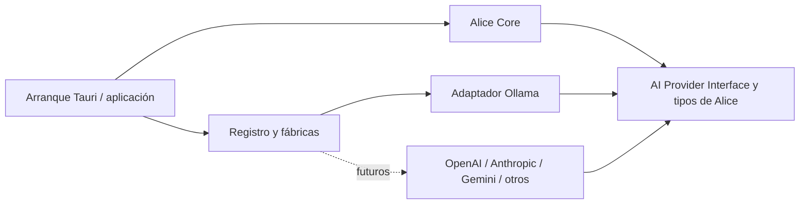

# Alice 2.0 — arquitectura y contratos del núcleo

Fecha: **5 de noviembre de 2026**, America/Bogota.

Estado: **decisión arquitectónica obligatoria, aceptada por instrucción del usuario**. Este documento define el diseño que deberá respetar la implementación futura. Los contratos y adaptadores aquí descritos todavía no están implementados. El Paso C autoriza una interfaz de chat y respuestas de demostración mediante IPC. Los proveedores de IA continúan sin implementar.

## 1. Invariante permanente: independencia del proveedor

**Cambiar de proveedor o modelo para una capacidad ya contemplada no debe exigir modificaciones en Alice Core.** Ollama será el primer adaptador, no una dependencia estructural del asistente.

La regla rige durante toda la evolución del proyecto: conversación, agente, personalidad, memoria y herramientas utilizarán tipos y contratos propios de Alice. Los protocolos, SDK, autenticación, endpoints y peculiaridades de los proveedores quedarán en infraestructura.

Se prevén adaptadores independientes para Ollama y, posteriormente, OpenAI, Anthropic, Gemini y otros proveedores. Esta previsión no afirma compatibilidad ya probada, no fija sus APIs y no autoriza a implementarlos ahora. Un servicio que anuncie compatibilidad con otro protocolo deberá validar su contrato y capacidades antes de habilitarse.

Los contratos podrán evolucionar para añadir capacidades del producto de forma genérica y versionada. Incorporar otro proveedor que implemente un contrato existente deberá limitar los cambios a su adaptador, registro de arranque, configuración y pruebas.

## 2. Fronteras y dirección de dependencias

Se adopta una arquitectura de puertos y adaptadores: un **puerto** describe lo que Alice necesita del servicio de inferencia; un **adaptador** traduce ese contrato al servicio concreto.

| Área | Responsabilidad | Dependencias permitidas para esta frontera |
|---|---|---|
| Alice Core | Conversación, contexto, decisiones del agente, personalidad y políticas de memoria/herramientas | Tipos de dominio y AI Provider Interface |
| Contratos de IA | Mensajes, solicitudes, respuestas, capacidades, eventos, cancelación y errores normalizados | Tipos neutrales de Alice; sin SDK ni formatos de proveedor |
| Adaptador de proveedor | Traducir solicitudes, ejecutar inferencia, interpretar protocolo y normalizar resultados | Contratos de IA, transporte y resolución de credenciales de infraestructura |
| Configuración/registro | Identificar instancias, validar configuración y resolver el adaptador solicitado | Fábricas de adaptadores; configuración no secreta |
| Arranque Tauri/aplicación | Construir servicios y entregar dependencias al núcleo | Core, registro y adaptadores concretos |
| React/TypeScript | Presentación y controles sobre IPC | DTO de aplicación; no clientes de inferencia ni secretos persistidos |

El diagrama representa **dependencias de código**, no el orden de las llamadas:

El puerto y sus tipos son propiedad del dominio de Alice y podrán vivir junto al núcleo o en un módulo de contratos neutral. No pertenecerán al módulo Ollama. La aplicación inyectará en Core una implementación del puerto; Core podrá usarla sin importar el módulo concreto.

**Alice Core no importará SDK de proveedores, adaptadores, clientes HTTP, DTO de Ollama ni tipos de respuesta de transporte.** No seleccionará comportamiento mediante `if provider == "ollama"`, URLs fijas, nombres comerciales de modelos o códigos de error específicos. Tampoco dependerá de Tauri para ejecutar sus reglas de negocio.

El registro inicial puede ser una tabla de fábricas en Rust. No se introduce un sistema de plugins dinámicos, microservicios, un servidor backend adicional ni dependencias nuevas por esta decisión. La forma exacta del trait asíncrono, stream y señal de cancelación se resolverá al implementar la fase de IA, manteniendo estos contratos.

## 3. Proveedor, modelo y subsistemas separados

| Concepto | Significado en Alice |
|---|---|
| Tipo de adaptador | Implementación de un protocolo concreto, registrada en infraestructura |
| Instancia de proveedor | Configuración identificada que usa un adaptador: endpoint, opciones de conexión y referencia a credenciales |
| Modelo | Identificador de modelo dentro de una instancia de proveedor, con capacidades y límites propios |
| Agente | Orquestación del trabajo: objetivos, turnos, límites, contexto y solicitudes de herramientas |
| Personalidad | Identidad y configuración de comportamiento de Alice, independientes del modelo |
| Memoria | Almacenamiento, procedencia y recuperación de información; independiente de la inferencia |
| Herramientas | Acciones registradas, validación, autorización y ejecución bajo políticas de Alice |

La misma implementación de adaptador podrá tener varias instancias con endpoints distintos. Una instancia podrá ofrecer varios modelos. Un agente seleccionará una referencia de modelo y declarará las capacidades que necesita; su identidad no será el nombre de un modelo ni un objeto de un SDK externo.

Los identificadores de instancia y modelo serán opacos y extensibles. Core no tendrá una enumeración cerrada de marcas que haya que editar al añadir cada proveedor. Los nombres que necesite el protocolo solo se interpretarán en configuración/infraestructura.

El constructor de contexto combinará personalidad, historial y memoria antes de invocar el puerto. El adaptador recibirá el contexto preparado; no leerá por su cuenta perfiles, bases de datos ni archivos de Alice.

## 4. AI Provider Interface

La interfaz común deberá cubrir estas operaciones y semánticas:

| Operación conceptual | Entrada | Salida/garantía |
|---|---|---|
| Consultar capacidades de modelo | Referencia de modelo y contexto de cancelación/plazo | Capacidades y límites con estado conocido o desconocido |
| Generar respuesta completa | Solicitud normalizada y contexto de cancelación/plazo | Respuesta normalizada o error tipado |
| Generar mediante streaming | La misma solicitud y contexto | Secuencia ordenada de eventos normalizados con un único evento terminal |

La cancelación forma parte del contrato desde el inicio. No se obliga a todos los servicios a ofrecer una operación remota de aborto idéntica; el adaptador declara el alcance real de esa capacidad.

Una implementación que no soporte streaming deberá rechazar esa modalidad mediante un error normalizado. La aplicación podrá elegir explícitamente la modalidad completa al conocer esa limitación. No presentará una respuesta completa como si fuera streaming nativo.

El puerto no incorporará bucles de agente, persistencia, personalidad, selección de recuerdos ni ejecución de herramientas. Una implementación de prueba en memoria deberá poder sustituir a cualquier proveedor para probar Core sin red.

## 5. Tipos y representación comunes

Los nombres siguientes son contratos conceptuales; no constituyen código ni una API ya publicada.

| Tipo | Contenido y reglas |
|---|---|
| `ModelRef` | ID de instancia de proveedor e ID de modelo; no presupone unicidad global del nombre comercial |
| `AiMessage` | ID, rol neutral (`system`, `user`, `assistant`, `tool`) y partes ordenadas de contenido |
| `AiRequest` | ID de operación, modelo, instrucciones/contexto, mensajes, parámetros, capacidades requeridas y, cuando corresponda, contratos de herramientas/formato de salida |
| `GenerationOptions` | Opciones comunes opcionales: límite de salida, temperatura, top-p o secuencias de parada; validadas frente al modelo |
| `AiResponse` | Contenido normalizado, llamadas de herramienta si existen, motivo de finalización, uso disponible e identificación del modelo reportado cuando se conozca |
| `Usage` | Contadores opcionales con procedencia; ausencia de dato se representa como desconocida, no como cero |
| `ToolDefinition` / `ToolCall` / `ToolResult` | Esquema neutral, nombre e ID de correlación; propuesta de llamada y resultado separados |
| `ProviderError` | Categoría neutral, ID de operación, mensaje seguro y datos normalizados de recuperación |

La representación inicial de conversación será textual. El contrato de partes de mensaje permitirá evolucionar hacia medios o contenido estructurado sin guardar objetos de un SDK en el historial. No se implementa soporte multimodal ahora.

Los mensajes de herramientas se relacionarán con sus llamadas mediante IDs, no por coincidencia de texto. El adaptador traducirá las diferencias de roles, bloques de instrucciones y orden de mensajes. Si no puede representar fielmente una solicitud, devolverá un error; no rebajará en silencio la prioridad de las instrucciones.

La respuesta distinguirá el modelo solicitado del modelo reportado por el servicio, si este último está disponible. Los motivos de terminación serán neutrales —por ejemplo, final normal, límite de salida, petición de herramienta, rechazo u otro—. Los valores desconocidos no se interpretarán automáticamente como éxito.

El historial y la persistencia futuros conservarán tipos de Alice. Al cambiar de proveedor se reconstruirá su representación de contexto a partir de esos datos; no será necesario migrar conversaciones entre formatos propietarios.

## 6. Streaming, cancelación y ciclo de vida

Cada operación tendrá un ID de solicitud propio, y cada evento llevará ese ID y un número de secuencia monotónico. Una invocación de streaming podrá emitir inicio, fragmentos de texto, fragmentos de llamadas de herramienta y actualización de uso, seguidos por **un solo terminal**:

- `Completed`: respuesta final válida y motivo de terminación conocido por el adaptador.
- `Cancelled`: cancelación local aceptada, contenido parcial identificado y alcance del aborto remoto cuando se conozca.
- `Failed`: error normalizado, con referencia al contenido parcial si lo hubo.

No se emitirán eventos después del terminal. El adaptador deberá detectar y comunicar un stream truncado o inválido. La desaparición de una conexión sin final válido no equivale a respuesta completada. La aplicación deberá producir un cierre local normalizado incluso si se pierde el transporte de UI o vence el plazo.

La aplicación asignará un único responsable de cerrar la operación y resolverá carreras entre finalización, error y cancelación. Los eventos tardíos de una operación cerrada se ignorarán mediante su ID. Así se evita mezclar fragmentos de una generación cancelada con otra nueva.

La respuesta final servirá para reconciliar el contenido acumulado, sin volver a añadir sus textos a lo ya mostrado. Los fragmentos de llamadas de herramientas no se ejecutarán: primero deberán formar una llamada completa y validada.

Cancelar detendrá la entrega local de resultados y solicitará el aborto del transporte/operación remota cuando sea posible. Se distinguirá entre aborto remoto confirmado, intento sin confirmación y cancelación solo local; no se prometerá que desaparecieron consumo o cargos del servicio externo.

Una respuesta interrumpida no se tratará como turno completado ni se convertirá automáticamente en un hecho de memoria. La política de conservación de borradores parciales pertenece a conversación/persistencia, con un estado explícito.

## 7. Capacidades y límites por modelo

Las capacidades se evaluarán para la **combinación de adaptador, instancia, modelo y configuración**. No se mantendrá en Core una tabla fija que atribuya capacidades a una marca completa.

El conjunto describirá, según corresponda, texto, streaming, llamadas de herramientas, salida estructurada, modalidades de entrada/salida, parámetros admitidos, límites de contexto/salida y alcance de cancelación. Los flags usarán estados **soportado, no soportado o desconocido**. Los límites o métricas no disponibles serán opcionales.

La información podrá proceder de metadatos del servicio, de un contrato validado del adaptador o de configuración explícita comprobada. Se registrará su origen y vigencia. Una declaración de compatibilidad de protocolo no basta para inferir capacidades del modelo.

Antes de enviar una solicitud:

1. Comparar las capacidades requeridas por el flujo con las disponibles.
2. Validar opciones y rangos. No enviar parámetros específicos de otro proveedor ni ignorarlos silenciosamente.
3. Ajustar el presupuesto de contexto a los límites conocidos del modelo. La estimación de tokens específica de un modelo quedará detrás de una abstracción neutral; Core no importará un tokenizer de proveedor.
4. Rechazar capacidades esenciales no soportadas o no verificadas con un motivo claro. Una alternativa de modalidad o modelo requerirá una política explícita y observable.

Las métricas de tokens y uso se conservarán con su procedencia; no se presumirá que representan idéntica tokenización o costes entre modelos. No se añaden precios ni reglas de facturación al núcleo.

## 8. Errores y recuperación

Categorías iniciales previstas: configuración/solicitud inválida, capacidad no disponible, autenticación, autorización, modelo no disponible, endpoint/conexión no disponible, timeout, límite de uso, contexto excedido, fallo del proveedor y protocolo/respuesta inválida. La cancelación intencional tendrá el cierre propio descrito arriba.

El adaptador traducirá los errores de transporte o SDK a estas categorías. Core no inspeccionará códigos HTTP, clases de excepciones o cadenas de error comerciales para decidir qué ocurrió.

Los errores incluirán un ID de operación y un mensaje apto para la interfaz. Podrán indicar si procede reintentar y un plazo de espera sugerido, cuando se conozca. Los diagnósticos detallados quedarán en infraestructura, redactados y correlacionados; no se filtrarán cuerpos o cabeceras sensibles al núcleo ni a la UI.

La política de reintentos pertenecerá a aplicación/orquestación, con presupuesto limitado. No se reintentará automáticamente una generación ya parcialmente entregada ni una secuencia de herramientas con efectos. Se evitarán políticas independientes de reintento que multipliquen solicitudes entre adaptador, agente y UI.

Un fallo de inferencia será un resultado de operación fallida, no un mensaje normal de Alice. Tampoco provocará cambio silencioso de proveedor, modelo o endpoint, especialmente desde un servicio local hacia uno externo.

## 9. Configuración y cambio de proveedor

Cada instancia tendrá configuración no secreta propia: ID, tipo de adaptador registrado, nombre visible, endpoint validado, modelo predeterminado/referencias de modelos, parámetros de conexión y referencia a credenciales. La configuración del agente y de personalidad se almacenará por separado.

El registro resolverá el tipo de adaptador y construirá la instancia fuera de Core. No habrá URLs ni nombres de modelos fijos en las reglas del núcleo. Cada adaptador validará su endpoint y combinación de opciones antes de usarse.

Al iniciar una generación se tomará una instantánea de instancia, modelo y configuración efectiva. Una edición de configuración no cambiará el destino de una operación en curso. Para cambiar durante una generación habrá que cerrarla o cancelarla primero. Los turnos nuevos reconstruirán su contexto según las capacidades y límites del nuevo modelo.

No se enviarán datos a un servicio remoto por el simple hecho de registrar su adaptador. Su activación y selección deberán ser explícitas, sujetas a la política de envío de datos de Alice. No se incorpora failover externo automático ni se autoriza ninguna comunicación externa con este documento.

## 10. Protección de credenciales

Se establece un contrato `SecretStore`/resolución de credenciales en infraestructura, separado de los contratos de inferencia. Las credenciales persistentes utilizarán el almacén protegido del sistema operativo mediante un adaptador nativo: credenciales de Windows, Keychain en macOS o el servicio de secretos disponible en Linux. La API/biblioteca concreta y su disponibilidad se validarán por plataforma antes de habilitar el primer proveedor externo; si no hay un almacén seguro disponible, no se persistirán secretos en texto plano. No se diseñará cifrado casero ni se persistirán claves en texto plano.

Reglas obligatorias:

- Guardar en configuración únicamente referencias a secretos. No incluir claves en SQLite sin protección, JSON, repositorio, prompts, historial, memoria, logs ni bundles frontend.
- Resolver la credencial en Rust, cerca del transporte del adaptador, con exposición mínima en memoria. Alice Core y el agente no recibirán claves como parte de `AiRequest`.
- React no almacenará ni utilizará claves para inferencia. Si un formulario las recibe para configurar el servicio, las enviará de forma transitoria por IPC validado al backend, limpiará su estado y no las conservará en almacenamiento web ni telemetría. Las consultas posteriores devolverán estado configurado y referencia, sin revelar el valor.
- No usar variables públicas del frontend, incluidas `VITE_*`, para secretos. Los registros y errores deberán redactar autenticación, cabeceras sensibles y cuerpos que puedan contener credenciales.
- Mantener el endpoint de configuración libre de contraseñas o claves incrustadas. Para proveedores externos se utilizará HTTPS con validación TLS; HTTP local deberá estar permitido explícitamente para destinos locales. No se reenviarán credenciales a otro destino por una redirección sin validar.
- Permitir reemplazar y eliminar credenciales, con aislamiento entre instancias. Un proveedor que no requiera clave no tendrá que recibir una credencial ficticia.

El mecanismo de almacenamiento y redacción deberá estar probado antes de habilitar un adaptador que use secretos. El primer adaptador local no justifica aplazar ese requisito hasta después de activar un proveedor externo.

## 11. Herramientas, personalidad y memoria bajo control de Alice

Los adaptadores producen contenido o propuestas de llamadas; **no ejecutan herramientas**. Alice validará nombre, argumentos, capacidades, permisos y confirmaciones aplicables antes de ejecutar una acción. El modelo nunca sustituirá esos controles.

Los resultados se representarán mediante tipos neutrales para continuar la conversación. La relación entre llamada y resultado se conservará aunque cambie el proveedor en un turno posterior, siempre que el nuevo modelo admita ese contexto.

La personalidad se aplicará desde el contexto de Alice; el adaptador solo hará la traducción necesaria de instrucciones. La memoria seleccionará información relevante y conservará su procedencia mediante sus propios servicios. Ningún adaptador decidirá automáticamente qué guardar como recuerdo ni recibirá acceso directo a la base de datos.

## 12. Orden de implementación y verificación futura

El Paso C autorizado de Fase 0 incluye una interfaz gráfica de chat, historial de sesión, respuesta de demostración mediante Rust/IPC, manejo visual de errores y build de producción. No se introducen llamadas de IA ni módulos vacíos de proveedores.

En la fase de conversación/IA se implementarán el contrato mínimo, un proveedor simulado para pruebas y el primer adaptador Ollama. Los proveedores externos se incorporarán posteriormente, cada uno con sus pruebas de contrato y configuración. Memoria persistente, herramientas y demás funcionalidades mantendrán sus fases acordadas.

Criterios permanentes para revisiones y pruebas cuando exista código:

1. Core puede compilarse y probarse sin módulos, SDK ni servicio Ollama; sus pruebas no necesitan red.
2. Dos implementaciones simuladas intercambiables ejecutan el mismo flujo de Core sin modificarlo.
3. Cambiar una instancia/modelo modifica configuración y resolución de dependencias, no conversación, personalidad, memoria ni agente.
4. Cada adaptador supera una suite común de mensajes, errores, secuencias de streaming, cancelación, límites, validación de capacidades y protección de secretos.
5. Se cubren stream truncado, eventos tardíos, cancelación en carrera, llamada incompleta de herramienta y parámetros no soportados.
6. Las comprobaciones de dependencias impiden importaciones o referencias específicas de proveedores en Core. La configuración y contratos persistidos permanecen neutrales y versionables.
7. Añadir un proveedor no cambia credenciales ni políticas de envío de otro, no habilita llamadas externas automáticamente y no altera permisos de herramientas.

Estas pruebas son criterios previstos, no resultados obtenidos en esta tarea. Las versiones de SDK o protocolos se comprobarán al implementar cada adaptador; no se inventan matrices de compatibilidad por proveedor.

## 13. Cómo se evita la dependencia de Ollama

Core construye una solicitud con tipos de Alice y llama al puerto inyectado. La aplicación resuelve la configuración y entrega el adaptador adecuado. Ollama traduce esa solicitud a su protocolo y devuelve los mismos tipos de respuesta/evento/error que deberá respetar cualquier otro adaptador.

Sustituir Ollama por otro proveedor compatible con las capacidades solicitadas cambia la implementación inyectada y la referencia de modelo. La lógica de conversación, agente, personalidad, memoria y permisos sigue usando el mismo contrato. Si el nuevo modelo no ofrece una capacidad requerida, se comunica esa incompatibilidad mediante el contrato común, sin añadir excepciones comerciales a Core.

Esta es una condición de aceptación de todos los cambios futuros. La auditoría histórica permanece en el proyecto anterior, sin copiar datos ni modificar sus archivos. Este documento fija la decisión normativa del proyecto nuevo Alice 2.0.
