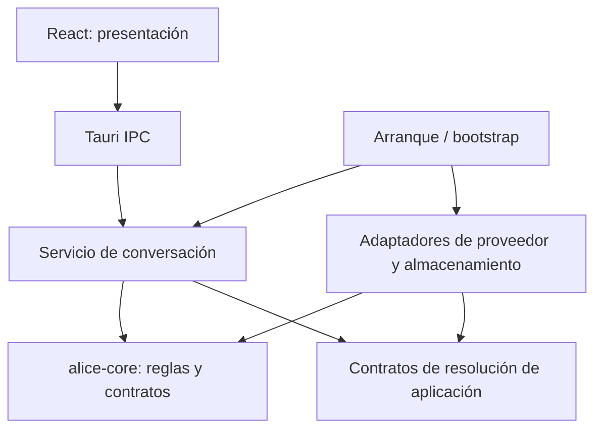
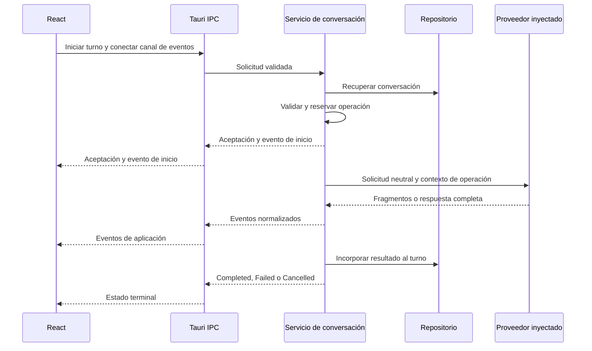
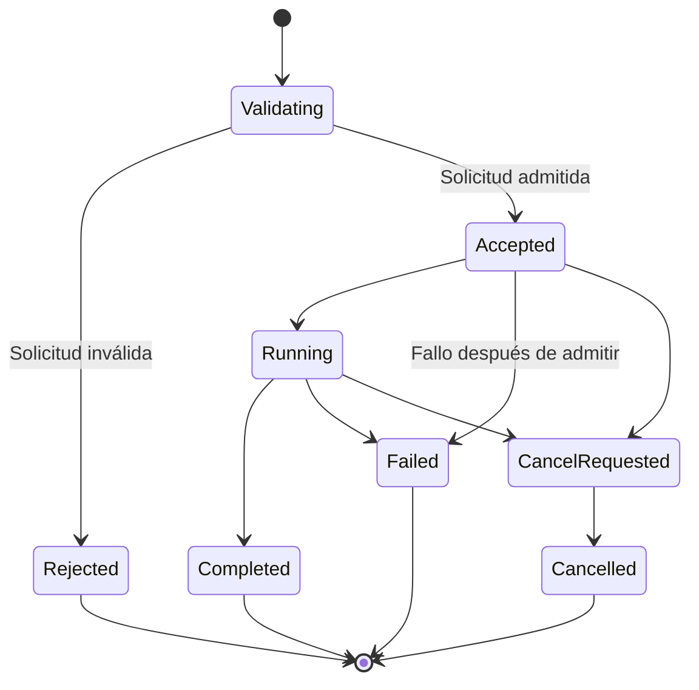

# Alice 2.0 — Plan técnico de la Fase 1

Fecha: 5 de noviembre de 2026.

Estado: **propuesta de planificación pendiente de autorización para implementar**. La solicitud de guardar este documento autoriza únicamente su creación. No autoriza crear módulos, modificar código o configuraciones, instalar dependencias ni iniciar la Fase 1.

Revisión documental: aclaraciones de futuros/streams, cancelación neutral, capacidades, registro de proveedores, límites y criterios de aceptación. Esta revisión no autoriza implementación.

## 1. Objetivo y alcance

Construir los fundamentos del núcleo Rust para administrar conversaciones e incorporar proveedores de IA independientes, conservando puntos de integración para memoria, personalidad, agentes, herramientas, voz y persistencia.

La recomendación es cerrar esta fase mediante dos proveedores simulados intercambiables, sin red. Ollama será el primer adaptador real y se incorporará en una etapa expresamente autorizada, después de comprobar las fronteras del núcleo.

Este plan desarrolla [ARCHITECTURE.md](ARCHITECTURE.md), [CHAT_INTEGRATION.md](CHAT_INTEGRATION.md) y los resultados de [PHASE_0_STEP_C.md](PHASE_0_STEP_C.md). Los árboles, nombres y firmas siguientes son propuestas; no describen módulos ya implementados.

### Clasificación del alcance

| Nivel | Contenido |
|---|---|
| Obligatorio | Core independiente de Tauri, Tokio, tokio-util y proveedores; contratos neutrales; lógica de conversación en Rust; operaciones identificadas; errores tipados; cancelación explícita; separación entre propuestas del modelo y ejecución de herramientas. |
| Recomendado para Fase 1 | Crate independiente para Core; conversaciones en memoria administradas por Rust; dos proveedores simulados; pruebas de streaming, cancelación y recuperación; adaptación del transporte IPC. |
| Futuro | Ollama y proveedores externos, SQLite/SQLx, memoria semántica, personalidad funcional, agentes, herramientas y voz. Sin módulos vacíos para estos subsistemas. |

## 2. Estructura propuesta de módulos Rust

Se recomiendan dos crates: el backend de escritorio existente y un crate pequeño `alice-core`. No se propone un crate por subsistema.

```text
Alice2/
├── crates/
│   └── alice-core/
│       ├── Cargo.toml
│       ├── src/
│       │   ├── lib.rs
│       │   ├── message.rs
│       │   ├── conversation.rs
│       │   ├── operation.rs
│       │   ├── provider.rs
│       │   ├── storage.rs
│       │   └── error.rs
│       └── tests/
│           └── conversation_rules.rs
└── src-tauri/
    ├── Cargo.toml
    ├── src/
    │   ├── main.rs
    │   ├── lib.rs
    │   ├── bootstrap.rs
    │   ├── ipc/
    │   │   ├── mod.rs
    │   │   ├── commands.rs
    │   │   └── dto.rs
    │   ├── application/
    │   │   ├── mod.rs
    │   │   ├── conversation_service.rs
    │   │   └── operations.rs
    │   └── infrastructure/
    │       ├── mod.rs
    │       ├── storage.rs
    │       └── providers/
    │           ├── mod.rs
    │           └── simulated.rs
    └── tests/
        ├── provider_contract.rs
        └── conversation_service.rs
```

Los archivos se introducirán cuando su etapa tenga comportamiento y pruebas. El árbol no implica crear toda la estructura al comenzar.

| Módulo | Responsabilidad |
|---|---|
| `alice-core/message.rs` | Identidad, rol y contenido de mensajes neutrales. |
| `alice-core/conversation.rs` | Conversaciones, turnos y reglas para incorporar resultados al historial. |
| `alice-core/operation.rs` | Identificación, estados, eventos y contratos de cancelación. |
| `alice-core/provider.rs` | AI Provider Interface, solicitudes, respuestas y capacidades. |
| `alice-core/storage.rs` | Contrato mínimo para recuperar y guardar conversaciones. |
| `alice-core/error.rs` | Categorías neutrales de error y recuperabilidad. |
| `application/conversation_service.rs` | Recibir texto, preparar contexto, invocar proveedor y actualizar la conversación. |
| `application/operations.rs` | Registro de operaciones, plazos, cancelación y resolución de carreras. |
| `infrastructure/storage.rs` | Almacenamiento en memoria durante Fase 1. |
| `infrastructure/providers/mod.rs` | Registro concreto de instancias, resolución y acceso a instantáneas de capacidades; implementa contratos de aplicación, sin exponer marcas al servicio. |
| `infrastructure/providers/simulated.rs` | Dos comportamientos intercambiables de prueba, sin red. |
| `ipc/commands.rs` | Entrada Tauri, validación del DTO y delegación en aplicación. |
| `ipc/dto.rs` | Representación serializable para React y conversiones desde tipos internos. |
| `bootstrap.rs` | Construcción de servicios, registro de proveedores e inyección de dependencias. |

Core contiene tipos, contratos y reglas. Aplicación contiene la orquestación asíncrona. Infraestructura contiene los detalles de los adaptadores. Tauri permanece en la frontera IPC y el arranque.

## 3. Arquitectura y flujo de mensajes

### Dependencias de código



Core no conocerá la implementación del registro de proveedores, HTTP, Tauri, Tokio ni SQLx. El arranque entregará a aplicación las implementaciones de los contratos que necesite. Los contratos de resolución pertenecen a aplicación y utilizan tipos neutrales de Core; no se introduce otro crate para ellos.

### Recorrido de un turno



## 4. Contratos fundamentales

Los nombres son propuestas de diseño, no una API publicada.

| Contrato | Contenido principal |
|---|---|
| `ConversationId` | Identificador de conversación creado por Rust. |
| `MessageId` | Identificador independiente del texto o la posición visual. |
| `OperationId` | Identificador de operación; puede conservar el actual `requestId`, validado y registrado por Rust. |
| `Message` | ID, rol, contenido y fecha. Contenido inicialmente textual. |
| `Turn` | Mensaje de entrada, operación asociada, respuesta opcional y estado del turno. |
| `Conversation` | ID, revisión y turnos; sin objetos de proveedores. |
| `ModelRef` | ID de instancia de proveedor e ID opaco del modelo. |
| `AiRequest` | Operación, modelo, contexto preparado, opciones y capacidades requeridas. |
| `AiResponse` | Contenido final, motivo de finalización, uso opcional y modelo reportado cuando exista. |
| `OperationContext` | ID, plazo y señal de cancelación, sin tipos de Tauri. |
| `OperationEvent` | Conversación, operación, secuencia y contenido del evento. |

El contrato inicial de mensajes admitirá `system`, `user` y `assistant`. Herramientas y otras modalidades ampliarán el contrato cuando exista una funcionalidad que las utilice, sin introducir payloads de SDK en el historial.

### Conversaciones y contexto

Rust será la fuente autoritativa de conversaciones y operaciones. React mantendrá una representación para presentar la interacción.

Reglas iniciales recomendadas:

- Una generación activa por conversación, sin cola implícita.
- Contexto preparado en Rust.
- Turnos fallidos o cancelados identificados en el historial, sin incorporarlos automáticamente como intercambios completados al contexto.
- Reintentos como operaciones nuevas relacionadas con la anterior.
- Resultados parciales diferenciados de respuestas completas.
- Revisión de conversación para detectar actualizaciones sobre un estado desfasado.

Puede conservarse inicialmente el límite de entrada de 2000 caracteres como política de aplicación. Los límites del modelo se representarán por separado.

### Errores

| Familia | Ejemplos |
|---|---|
| Dominio/aplicación | Entrada inválida, conversación inexistente, conversación ocupada y conflicto de revisión. |
| Proveedor | Modelo no disponible, capacidad incompatible, conexión, autenticación, cuota, contexto excedido o protocolo inválido. |
| Infraestructura | Almacenamiento, transporte IPC o fallo interno. |

React recibirá códigos estables, correlación y mensajes seguros. Los diagnósticos internos permanecerán separados y redactados. No se enviarán errores crudos de SDK al frontend.

La cancelación solicitada por el usuario tendrá resultado propio. Un plazo vencido terminará como `Failed` con categoría `Timeout`.

## 5. Abstracción de proveedores

Se recomienda una interfaz dinámica común, seleccionada por configuración e inyectada en el servicio.

### 5.1. Futuros y streams: procedencia y solución mínima

La verificación de documentación y código fuente confirma:

| Elemento | Procedencia |
|---|---|
| `Future`, `Pin`, `Box`, `Arc` | Biblioteca estándar de Rust; no requieren un crate adicional. |
| `Stream` | `futures_core::Stream`; no lo proporciona el trait `Future` de `std`. |
| `BoxFuture` y `BoxStream` existentes | Los define `futures-core` y los reexporta `futures-util` con las características correspondientes. No es necesario añadir `futures-util` para esos alias. |
| `FutureExt` / `StreamExt` y combinadores | Utilidades de `futures-util`, distintas de los contratos básicos. |

Solución mínima recomendada: definir el alias de futuro con tipos estándar y usar únicamente el trait `Stream` de `futures-core` para el contrato de streaming. Los alias pertenecen a los módulos de contratos existentes, sin crear un módulo vacío de utilidades.

```rust
use std::{future::Future, pin::Pin};

pub type BoxFuture<'a, T> =
    Pin<Box<dyn Future<Output = T> + Send + 'a>>;

pub type ProviderStream =
    Pin<Box<dyn futures_core::Stream<Item = ProviderEvent> + Send + 'static>>;
```

`BoxFuture` en las firmas siguientes significa el alias local, no un import implícito de `futures-util`. Usar directamente el alias equivalente de `futures-core` también sería válido; el alias local explicita que los futuros no necesitan esa dependencia. No se añade un executor a Core ni se implementa un trait de stream casero. El stream devuelto es propietario: no retiene referencias prestadas a una configuración temporal.

`ProviderEvent` llevará la correlación de operación y un payload neutral: inicio, fragmento, uso o terminal completo/fallido/cancelado. El servicio validará esa correlación y producirá el sobre `OperationEvent` con su secuencia autoritativa hacia React.

Fuentes verificadas: [Future estándar](https://doc.rust-lang.org/std/future/trait.Future.html), [BoxFuture de futures-core](https://docs.rs/futures-core/latest/futures_core/future/type.BoxFuture.html), [Stream](https://docs.rs/futures-core/latest/futures_core/stream/trait.Stream.html), [BoxStream](https://docs.rs/futures-core/latest/futures_core/stream/type.BoxStream.html) y [reexportación en futures-util](https://docs.rs/futures-util/latest/src/futures_util/future/mod.rs.html).

### 5.2. Interfaz común

Firmas conceptuales, no implementación compilada:

```rust
trait AiProvider: Send + Sync {
    fn declared_capabilities(&self) -> AdapterCapabilities;

    fn capabilities(
        &self,
        model: ModelRef,
        context: OperationContext,
    ) -> BoxFuture<'_, Result<ModelCapabilities, ProviderError>>;

    fn complete(
        &self,
        request: AiRequest,
        context: OperationContext,
    ) -> BoxFuture<'_, Result<AiResponse, ProviderError>>;

    fn stream(
        &self,
        request: AiRequest,
        context: OperationContext,
    ) -> BoxFuture<'_, Result<ProviderStream, ProviderError>>;
}
```

`declared_capabilities` es local y no hace red. `capabilities` obtiene información específica del modelo; puede requerir descubrimiento autorizado, por lo que no se llamará incondicionalmente por mensaje. Las firmas y sus lifetimes se concretarán y probarán al autorizar la implementación.

Se recomiendan futuros explícitos para permitir `Arc<dyn AiProvider>` sin añadir inicialmente `async-trait`. La [referencia oficial de Rust](https://doc.rust-lang.org/reference/items/traits.html#dyn-compatibility) documenta las restricciones de compatibilidad dinámica de métodos `async fn`.

Cada adaptador deberá:

1. Validar instancia, modelo y opciones.
2. Traducir solicitudes neutrales al protocolo concreto.
3. Gestionar conexión y autenticación en infraestructura.
4. Normalizar respuestas, eventos y errores.
5. Respetar plazos y cancelación.
6. No seleccionar recuerdos ni ejecutar herramientas.

Ollama será el primer adaptador real de infraestructura. OpenAI, Anthropic, Gemini u otros añadirán adaptadores, configuración y pruebas. Para capacidades ya contempladas, no modificarán Core.

### 5.3. Cancelación independiente del runtime

La señal de Core expresa una **solicitud**. Consultarla o esperar su activación no confirma que una tarea, un transporte o una inferencia remota hayan terminado.

Interfaz conceptual en `alice-core/operation.rs`:

```rust
use std::{sync::Arc, time::Instant};

pub trait CancellationSignal: Send + Sync {
    fn is_requested(&self) -> bool;
    fn requested(&self) -> BoxFuture<'_, ()>;
}

pub struct OperationContext {
    pub operation_id: OperationId,
    pub deadline: Instant,
    pub cancellation: Arc<dyn CancellationSignal>,
}
```

Reglas del contrato:

- La señal pasa de no solicitada a solicitada una sola vez; no se reinicia ni se reutiliza entre operaciones.
- `is_requested` permite consultar sin bloquear. `requested` permite esperar sin sondeo periódico; si la señal ya está activada, resuelve inmediatamente.
- No debe perderse una solicitud entre consultar y registrar la espera. Descartar el futuro de espera no revoca la solicitud.
- Los adaptadores reciben el mismo contexto y observan la señal durante conexión, lectura y espera de eventos. No reciben la autoridad para cancelar otras operaciones.
- La autoridad para solicitar y aceptar cancelación está en `application/operations.rs`, no en React, el adaptador ni el trait de observación.

Aplicación podrá mantener un `tokio_util::sync::CancellationToken` privado y envolverlo para implementar este trait. Sus tipos y dependencias no cruzarán hacia Core. Para pruebas de Core se usarán dobles basados en `std`, sin Tokio. El token concreto, según su [documentación oficial](https://docs.rs/tokio-util/latest/tokio_util/sync/struct.CancellationToken.html), notifica solicitudes; no aporta confirmación remota.

Se distinguen tres resultados:

1. **Solicitud recibida:** respuesta de `cancel_operation`, como `Requested`, `AlreadyRequested`, `AlreadyFinished` o `NotFound`. `Requested` acredita registro de la solicitud y cierre de la vía de éxito tardío, no detención física del trabajo.
2. **Cierre local confirmado:** terminal `Cancelled` registrado por el coordinador; no se incorporarán nuevas respuestas al turno. El estado del transporte se indicará separadamente si no puede comprobarse su cierre.
3. **Alcance remoto:** `NotApplicable` para simulados locales, `Confirmed` solo con evidencia suficiente del protocolo remoto o `Unconfirmed` cuando no exista. Cerrar un socket o descartar un futuro no permite inferir `Confirmed`.

El coordinador serializa la aceptación de cancelación y el commit de una respuesta. Si acepta primero la cancelación, una finalización posterior se descarta. Si la respuesta ya quedó confirmada, no se reescribe como cancelada. La espera de limpieza tendrá un plazo acotado: su vencimiento permite cerrar localmente con alcance remoto no confirmado. No se promete detener cargos o consumo remoto.

### 5.4. Capacidades y procedencia

El estado de una capacidad y la evidencia sobre ella son dimensiones distintas. Se conservarán soporte (`Supported`, `Unsupported`, `Unknown`), procedencia, alcance y vigencia.

| Fuente | Qué permite conocer | Red |
|---|---|---|
| Declaración del adaptador | Protocolos y operaciones que implementa, formatos traducibles, parámetros reconocidos y mecanismo local de cancelación. No prueba capacidades de cualquier modelo. | Nunca para `declared_capabilities`. |
| Información específica del modelo | Contexto, salida máxima, modalidades u opciones de un modelo y una instancia concretos. Puede proceder de configuración explícita o metadatos del servicio. | No si hay configuración fiable o metadatos vigentes; posible consulta si el proveedor ofrece descubrimiento. |
| Verificación en ejecución | Evidencia de una capacidad realmente ejercida con esa instancia/modelo/configuración; por ejemplo, stream válido o rechazo tipado de una opción. No prueba capacidades que no se usaron. | Derivada de solicitudes ya autorizadas; no requiere un sondeo adicional por mensaje. |
| Desconocida | No hay evidencia suficiente, la información caducó o el proveedor no publica ese dato. | No obliga a probar por red; se conserva como desconocida o se rechaza una operación que la requiera. |

Las capacidades efectivas respetarán las limitaciones del adaptador: un modelo capaz de una modalidad no la habilita si su adaptador no la implementa. La existencia de un método remoto de cancelación tampoco demuestra el aborto de una operación concreta.

Para evitar consultas innecesarias:

- Los simulados proporcionan toda su información localmente y se verifica que no realizan red.
- El registro/resolvedor conserva instantáneas por instancia, modelo y revisión de configuración relevante, sin secretos en la clave ni en los eventos.
- Se reutiliza la instantánea vigente. El descubrimiento se realiza al seleccionar/activar un modelo cuando sea necesario, al actualizar explícitamente o después de una invalidación relevante, no automáticamente en cada turno.
- La política de vigencia se fija por fuente; no se inventa un TTL universal. Las consultas concurrentes para una misma clave comparten un único descubrimiento.
- Cambios de endpoint, modelo, adaptador o configuración invalidan su entrada. Un rechazo incompatible con metadatos almacenados los invalida sin asumir que todos los modelos cambiaron.
- Todo descubrimiento tiene plazo y cancelación y forma parte del presupuesto total si sucede dentro de una operación. No cambia silenciosamente de proveedor.
- Antes de inferencia se toma una instantánea de configuración y capacidades. La validación local de cada solicitud no implica volver a consultar al proveedor.

Si streaming no está soportado, se devolverá incompatibilidad o se elegirá explícitamente respuesta completa. No se presentará como streaming nativo una respuesta completa fragmentada artificialmente.

### 5.5. Registro y selección de proveedores

La solución inicial será un registro en memoria construido en `bootstrap.rs`: IDs de instancia asociados a implementaciones `Arc<dyn AiProvider>` ya configuradas. No habrá carga dinámica de plugins ni descubrimiento automático de servicios.

El servicio recibe un puerto `ProviderResolver` de aplicación, cuyo contrato conceptual es `resolve(ModelRef) -> Result<ResolvedProvider, SelectionError>`. Devuelve la implementación neutral y la configuración efectiva ligada a esa selección. La implementación del registro está en infraestructura. Ni el puerto ni el servicio importan tipos de simulados u Ollama.

La configuración inicial permitirá seleccionar `provider_instance_id` y `model_id`. El arranque registrará, por ejemplo, `demo-a` y `demo-b`, con dos implementaciones simuladas independientes y deterministas del mismo contrato. Cambiar esa selección o inyectar otro resolvedor en una prueba intercambia proveedores sin editar el servicio. Nombres e IDs de este ejemplo no se convierten en condiciones dentro de Core.

El resolvedor valida instancia/modelo antes de admitir la operación. Instancias desconocidas fallan explícitamente. La selección queda fijada para el turno en curso; editar la configuración afectará a turnos nuevos. El servicio no contendrá `if`, `match`, URLs, DTO o códigos de error específicos de marcas.

Posteriormente Ollama requerirá: un adaptador concreto, su configuración validada, registro en el arranque y pruebas del mismo contrato. Endpoint y posibles credenciales se resolverán en infraestructura. No cambiarán las reglas de Core ni el servicio de conversación para capacidades existentes. Las fábricas de adaptadores, si llegan a ser necesarias, permanecerán en el arranque/infraestructura; no se implementan por anticipado.

## 6. Servicio de conversación y ciclo de vida

La solicitud de aplicación incluirá conversación, operación, texto y selección de modelo. Endpoint y credenciales se resolverán en Rust, fuera de Core.

Secuencia del servicio:

1. Validar solicitud y correlación.
2. Detectar duplicados y comprobar disponibilidad de la conversación.
3. Recuperar conversación y configuración efectiva.
4. Reservar operación y registrar turno.
5. Construir contexto y verificar capacidades.
6. Invocar el proveedor inyectado.
7. Normalizar resultados y eventos.
8. Actualizar turno y cerrar operación.

No se mantendrán bloqueos globales durante inferencia ni durante entrega de eventos.

### Límites iniciales y comportamiento al alcanzarlos

Los dos valores de concurrencia siguientes son recomendaciones de alcance, no mediciones del equipo. Los presupuestos de memoria y tiempo todavía no tienen una cifra defendible: deben fijarse con mediciones de los simulados y pruebas de carga acotadas durante la implementación autorizada. No se presentan números inventados como requisitos ya validados.

**Los valores definitivos pueden estar pendientes; los límites efectivos no.** Desde la primera implementación de cada recurso deben existir presupuestos provisionales finitos, explícitos y documentados para memoria, historial, respuesta, cantidad y tamaño de eventos, buffers, plazos y retención. No se permite introducir temporalmente un límite ilimitado, un buffer sin capacidad definida, un plazo infinito ni retención indefinida como valor predeterminado. La ausencia de un valor definitivo no exime de aplicar uno provisional finito: si falta también este último, se rechaza la configuración y no se admite el trabajo afectado.

| Recurso | Recomendación inicial | Justificación y comportamiento |
|---|---|---|
| Operaciones por conversación | **1** operación no terminal, incluyendo `Accepted` y `CancelRequested`. | Garantiza un orden inequívoco de turnos y evita conflictos de contexto en la primera versión. Otro envío recibe `ConversationBusy`; no hay cola implícita. |
| Operaciones globales | **1** operación no terminal en la instancia de aplicación, compartida por todas las ventanas/conversaciones. Configurable fuera de Core. | La Fase 1 valida fundamentos con simulados, no rendimiento paralelo. Este mínimo evita afirmar una capacidad de hardware no medida. Otra conversación recibe `CapacityExceeded`; no se cambia de proveedor ni se encola en silencio. Las pruebas podrán configurar un límite superior para comprobar independencia entre operaciones. |
| Historial en memoria | Límite por conversación y global de turnos/mensajes y bytes de contenido UTF-8; cifras **pendientes**. | Debe impedir tanto muchos mensajes pequeños como pocos muy grandes. Se incluyen entradas, respuestas y parciales retenidos; el historial y el contexto del modelo tienen límites distintos. Si no cabe un nuevo turno, se rechaza antes de llamar al proveedor con `HistoryLimitExceeded`. No se eliminan turnos silenciosamente. |
| Respuesta acumulada | Presupuesto de bytes independiente de la cola; cifra **pendiente**. | Una cola pequeña no limita el texto que se acumula. Si la salida excede el presupuesto reservado, se solicita aborto y se cierra `Failed` con `OutputLimitExceeded`; el parcial acotado no se confirma como respuesta normal. |
| Buffers de streaming | Capacidad finita de eventos, máximo de bytes por evento/lote y presupuesto total de bytes pendientes; cifras **pendientes**. | El límite de cantidad por sí solo no evita un evento gigantesco. El adaptador debe producir fragmentos acotados sin romper UTF-8. Se aplica presión al productor sin descartar deltas silenciosamente. Si el consumidor no progresa dentro del plazo, se termina con error seguro y se conserva la instantánea recuperable. |
| Tiempo total | Un `deadline` obligatorio por operación, desde la admisión hasta su cierre, incluyendo preparación, descubrimiento y entrega interna; duración **pendiente**. | Se determinará según el trabajo medido de los simulados y el margen de planificación del sistema. No se heredará ese valor como SLA de Ollama. Al vencer: `Failed(Timeout)`, descarte de resultados tardíos y liberación de la reserva lógica. |
| Inactividad y limpieza | Plazos separados para ausencia de progreso del proveedor, consumidor bloqueado y limpieza tras cancelación; duraciones **pendientes**, limitadas por el plazo aplicable. | Un proveedor que envía indefinidamente no evita el deadline total. La limpieza no prolonga indefinidamente `CancelRequested`. |
| Conversaciones y operaciones retenidas | Límites globales de entradas y contenido, y política de retención/idempotencia; cifras definitivas **pendientes**, con valores provisionales finitos obligatorios desde su implementación. | También las conversaciones vacías y los registros terminales consumen memoria. Al agotarse la capacidad de admisión se rechaza explícitamente. No se borran operaciones activas ni se anticipa la expiración de registros protegidos por la política de retención descrita más abajo. |

La admisión reservará capacidad para el turno y un resultado acotado antes de aceptar trabajo, o lo rechazará. El contenido de salida no crecerá sin presupuesto y el cierre de error dispondrá de espacio reservado. La liberación de una reserva lógica no prueba que un servidor remoto haya parado: tareas locales de limpieza y transportes se supervisan y acotan aparte.

Para fijar los valores pendientes se medirán: tamaño y cantidad de turnos del escenario aprobado, bytes de eventos y respuesta máxima de los simulados, duplicación de snapshots/DTO, sobrecarga de estructuras y comportamiento de un consumidor lento. Los bytes UTF-8 son un presupuesto lógico, no una promesa exacta de memoria física; se comprobará también el uso de memoria del proceso.

Los presupuestos provisionales se elegirán y documentarán antes de implementar o habilitar cada recurso; incluirán justificación conservadora y se probará su aplicación efectiva. Durante la implementación autorizada se medirán y ajustarán los valores definitivos, que deberán documentarse y aprobarse antes de cerrar las etapas correspondientes, incluidas las etapas 2 y 4. Ningún límite pendiente se sustituirá por infinito, y una configuración incompleta o incoherente se rechazará antes de admitir operaciones. Los tests usarán límites pequeños explícitos para ejercitar los bordes; esas cifras de fixtures no serán valores de producción.

Se recomienda que reutilizar un ID con la misma solicitud devuelva su estado existente sin iniciar otra inferencia. Usar ese ID con contenido diferente devolverá conflicto. La duración de esta garantía depende de la retención de operaciones y deberá documentarse.

### Estados



`Rejected` es un rechazo de admisión por IPC. La garantía de terminal único corresponde a operaciones aceptadas.

Eventos mínimos: `Accepted`, `Started`, `TextDelta` cuando proceda, `UsageUpdated` cuando exista el dato, y un único terminal `Completed`, `Failed` o `Cancelled`. Todo `OperationEvent` lleva `conversation_id`, `operation_id` y secuencia estrictamente creciente dentro de esa operación, empezando en 1. El coordinador es el único que asigna esa secuencia; no reutiliza contadores globales ni confía en secuencias del protocolo del proveedor.

Un coordinador de aplicación resolverá el cierre. Los eventos posteriores al terminal se descartarán. Un stream que termine sin cierre válido producirá `Failed` por protocolo incompleto.

La aceptación de cancelación se registrará antes de confirmarla al usuario. Si ya hay un terminal, se devolverá «ya finalizada». Si la cancelación se acepta antes de completar, una respuesta posterior no podrá incorporarse como éxito.

Se distinguirán cancelación local, aborto remoto confirmado y alcance remoto desconocido. No se prometerá detener consumo remoto sin confirmación del proveedor.

Errores de proveedor, repositorio, validación tardía o transporte, EOF incompleto y fallos de la tarea supervisada deberán pasar por una ruta de cierre que registre el terminal y libere la reserva una sola vez. Los errores de entrega al frontend no impedirán guardar el resultado local. Un supervisor y los plazos impedirán que una tarea que falla o no termina mantenga la operación abierta indefinidamente. Esta garantía se limita al proceso vivo; recuperar el estado tras caída del proceso requiere persistencia futura y no se afirma en Fase 1.

### Autoridad terminal independiente del historial

El coordinador de operaciones es la autoridad sobre el estado y resultado terminal. Mantiene su propio registro en memoria, independiente del repositorio de conversaciones. Este registro conserva la correlación, el terminal, el resultado o error, el parcial o respuesta recuperable dentro de su presupuesto, el último número de secuencia y la información necesaria para recuperar la operación durante su retención. No requiere escribir con éxito el turno en el repositorio para existir o ser consultable; su capacidad se reserva al admitir la operación.

La actualización del historial y el cierre de la operación son resultados distintos:

- **Cerrar correctamente** significa registrar una sola decisión terminal y liberar una sola vez la reserva de ejecución. No significa necesariamente que la inferencia ni la actualización de la conversación hayan tenido éxito.
- **Actualizar correctamente la conversación** significa que el repositorio aceptó el cambio del turno y su revisión. No se declara conseguido por el solo hecho de haber cerrado la operación.
- Si guardar o actualizar el turno falla antes del cierre, o no termina dentro del plazo aplicable, el coordinador cierra la operación como `Failed` con el error de almacenamiento ya previsto, libera la reserva y conserva en su registro el resultado generado disponible como recuperable, sin presentarlo como incorporado al historial ni incluirlo automáticamente en contexto.
- Si ya existe un terminal, un fallo posterior al actualizar una proyección o entregar su resultado no lo reescribe ni emite otro terminal. La incidencia de actualización se comunica de forma separada y segura; tampoco borra el resultado registrado ni vuelve a ocupar la reserva.

La reserva de ejecución liberada y la memoria retenida del registro terminal son presupuestos distintos: cerrar libera capacidad de concurrencia, mientras que los datos recuperables siguen sujetos a su presupuesto y retención. No se mantiene una operación abierta para conservar su respuesta ni se espera indefinidamente al repositorio para liberar su reserva.

Las consultas de recuperación deben considerar el registro del coordinador además del repositorio. Un error al cargar el historial no debe ocultar ni destruir el estado terminal que siga retenido: se distingue la información operativa recuperable de la indisponibilidad o desactualización de la conversación, sin inventar que el turno fue guardado. No se añaden comandos, contratos generales ni estados terminales nuevos por esta precisión.

En Fase 1 ambos almacenamientos son exclusivamente en memoria y pertenecen al proceso vivo. Esta separación no introduce SQLite, archivos de recuperación, un log en disco ni garantías frente al cierre o caída del proceso.

### Entrega y recuperación

Se recomiendan colas acotadas para evitar crecimiento ilimitado. Los [canales limitados de Tokio](https://docs.rs/tokio/latest/tokio/sync/mpsc/index.html) permiten aplicar presión entre productor y consumidor.

El terminal quedará registrado aunque React cierre su canal. Un terminal único en backend no garantiza que la interfaz lo reciba: una consulta de estado recuperará la información de conversación y operación que continúe disponible dentro de la política de retención. Los fallos del repositorio no eliminan el registro operativo independiente.

La pérdida del canal desconecta al consumidor, no elimina la conversación, el registro de operación ni el parcial acotado. La política inicial recomendada es solicitar cancelación por desconexión; el coordinador decide el cierre y conserva su resultado durante la retención de sesión acordada. No se acumulan eventos sin consumidor para intentar reproducirlos indefinidamente. Al reconectar se recupera una instantánea con último número de secuencia y estado; no se reinicia automáticamente la inferencia.

El presupuesto debe abarcar el puente a React: una cola `mpsc` acotada no demuestra que la cola interna de IPC o JavaScript esté acotada. Se recomienda enviar lotes limitados y mantener una ventana finita de lotes pendientes de confirmación de React. El adaptador IPC gestiona las confirmaciones correlacionadas y la espera; Core no conoce canales ni acknowledgements. No se envían más lotes si se agota la ventana. Si no llegan confirmaciones dentro del plazo de consumidor, se aplica la política de desconexión/error y se preserva el estado. El terminal se registra aunque no pueda entregarse. El tamaño de lote y ventana se medirán junto con el resto de buffers.

La respuesta final reconciliará o reemplazará el contenido parcial; no volverá a añadirlo como un mensaje duplicado.

### Política configurable de retención y expiración

La recuperación e idempotencia se garantizan solo mientras sus registros sigan retenidos en memoria. La política tendrá parámetros explícitos y finitos desde su primera implementación: duración de retención de operaciones terminales, duración de inactividad de conversaciones, límites de cantidad/bytes y frecuencia máxima de limpieza. Las cifras definitivas se medirán, documentarán y aprobarán antes del cierre de las etapas correspondientes; mientras tanto se aplican presupuestos provisionales finitos, nunca retención indefinida.

**Operaciones activas:** ninguna política de retención elimina una operación no terminal, su reserva o la conversación que necesita. Incluye `Accepted`, `Running` y `CancelRequested`. Si excede su plazo, el coordinador debe cerrarla por el mecanismo de timeout/cancelación previsto, no hacerla desaparecer como limpieza. La retención terminal empieza después de registrar ese cierre.

**Operaciones terminales:** la duración se cuenta desde el registro del terminal con un reloj monotónico. Leer, confirmar recepción o reconectar React no reinicia ese plazo. Hasta su expiración se conserva el resultado recuperable y la información necesaria para devolver el estado existente a solicitudes idempotentes. La memoria que ocupa se reserva y acota; si no cabe admitir trabajo nuevo sin eliminar datos aún protegidos, se rechaza la admisión, no se acorta silenciosamente la garantía ofrecida.

**Conversaciones:** la inactividad se cuenta desde su creación o la última actividad significativa de un turno admitido o cerrado. Las consultas y sondeos no renuevan el plazo. Una conversación solo es elegible para expiración cuando se cumpla su plazo, no tenga operaciones activas y no sea necesaria para recuperar una operación terminal todavía retenida. Esta protección puede posponer su eliminación hasta que terminen ambas retenciones; no elimina ni amplía retroactivamente la retención propia de la operación. No se borra historial de una conversación vigente para simular que se respetó el presupuesto: se rechaza trabajo nuevo cuando corresponda.

**Limpieza y consultas:** la comprobación de expiración se realiza al consultar y antes de resolver duplicados, además de la limpieza periódica acotada. Un registro vencido deja de estar disponible lógicamente aunque su liberación física esté pendiente de la siguiente limpieza. La expiración y el cierre se coordinan para evitar que una operación activa se elimine por una carrera. Los cambios de configuración se aplicarán prospectivamente a registros nuevos; no reducirán silenciosamente los plazos ya asignados a los existentes.

| Situación tras la expiración | Comportamiento definido |
|---|---|
| Expira el registro terminal de una operación | Dejan de estar garantizados su resultado operativo, error, parcial recuperable, secuencia, confirmación de cancelación y deduplicación. Si su turno fue incorporado a una conversación aún conservada, ese contenido puede seguir visible como historial; no sustituye al registro operativo expirado. |
| Se consulta o cancela una operación que ya no está retenida | Se informa que no se encuentra; no se inventa un estado terminal ni se afirma que sigue ejecutándose. Sin un registro conservado no se distingue con certeza entre ID expirado e ID que nunca existió. No se introducen tombstones ilimitados para hacer esa distinción. |
| Se repite una solicitud después de olvidar su registro idempotente | Ya no existe garantía de deduplicación. Si vuelve a enviarse mediante la entrada de inicio y la conversación y demás validaciones lo permiten, se trata como una solicitud nueva y puede ejecutar trabajo otra vez. No se presenta como recuperación del resultado anterior. |
| React recibe que el estado anterior ya no se encuentra | No reenvía automáticamente la inferencia ni interpreta esa ausencia como cancelación o fallo original. Una nueva ejecución requiere acción explícita del usuario y un ID nuevo; los IDs de operación no deben reutilizarse. |
| Expira una conversación elegible | Dejan de estar disponibles su historial, revisión e instantánea de sesión. Las consultas o envíos dirigidos a ese ID informan conversación inexistente; no la recrean automáticamente ni reconstruyen datos a partir de coincidencias de texto. Una conversación nueva recibe otro ID. |
| Cierra o cae el proceso | Se pierde todo el estado en memoria, incluidos resultados e idempotencia, aunque no hubiera vencido el plazo. No se promete recuperación entre ejecuciones. |

Estas reglas limitan expresamente la garantía idempotente a la retención efectiva. No se afirma que un ID olvidado pueda detectarse para siempre. La interfaz deberá explicar la expiración de disponibilidad y no ofrecer una recuperación inexistente; las capacidades finitas y el rechazo de nueva admisión impiden resolver presión de memoria mediante una eliminación anticipada no comunicada.

La aplicación de estas precisiones se verifica dentro de los criterios A8, A9 y A10 existentes. No se modifica la matriz A1–A12, el orden de etapas, la estructura propuesta ni los contratos generales.

## 7. Integración con Tauri

| Comando propuesto | Función |
|---|---|
| `create_conversation` | Crear una conversación en memoria. |
| `get_conversation` | Obtener historial y estado de operación para sincronizar React. |
| `start_turn` | Admitir solicitud y conectar su canal de eventos. |
| `cancel_operation` | Solicitar cancelación y devolver aceptación o estado final. |
| `ack_operation_events` | Confirmar recepción de lotes hasta una secuencia enviada, para acotar eventos pendientes en el puente IPC. Propuesta vinculada al control de flujo, pendiente de aprobación con la implementación. |

Los comandos convertirán DTO, delegarán en aplicación y traducirán resultados. No contendrán llamadas a proveedores ni selección de contexto.

Las confirmaciones de eventos validarán conversación, operación, consumidor y secuencia enviada; no podrán avanzar más allá de lo emitido. Se procesarán por el adaptador IPC, sin confirmar respuestas de negocio ni modificar las reglas de turnos. La confirmación de recepción de un lote no es confirmación de cancelación ni de finalización de inferencia.

Para streaming se recomienda `tauri::ipc::Channel`, conectado antes de iniciar la operación. El tipo Tauri permanecerá exclusivamente en la frontera IPC; aplicación no lo recibirá como dependencia. Véase la [documentación oficial de canales Tauri](https://v2.tauri.app/develop/calling-frontend/#channels).

React conservará el diseño existente. Su transporte se ampliará para recibir eventos por operación y secuencia, mostrar parciales, solicitar cancelación y recuperar una instantánea cuando pierda sincronización.

## 8. Futuras funcionalidades

| Funcionalidad | Punto de integración previsto |
|---|---|
| Personalidad | Preparación de instrucciones y contexto antes del proveedor. |
| Memoria | Recuperación de información con procedencia para construir contexto. |
| Agentes | Orquestación de varios pasos mediante servicios y contratos de Core, fuera de adaptadores. |
| Herramientas | El modelo propone; aplicación valida esquema, permisos y confirmación antes de ejecutar. |
| STT | Texto revisable que utiliza el mismo caso de uso de envío. |
| TTS | Respuestas confirmadas por ID y operación de reproducción propia. |
| SQLite/SQLx | Implementación futura del contrato de almacenamiento. |

Detener audio y cancelar inferencia serán acciones distintas. No se introducirán motores de voz ni componentes vacíos en esta fase.

El almacenamiento tendrá operaciones específicas para recuperar y guardar conversaciones con revisión esperada; no un repositorio genérico para cualquier entidad. SQLx, consultas, conexiones y migraciones permanecerán en infraestructura. Core no recibirá filas ni tipos SQL. Cambiar de motor requerirá otro adaptador, no reescribir las reglas del núcleo.

Los permisos de herramientas se comprobarán en backend sobre acción y argumentos concretos. El modelo no concederá permisos. Una confirmación visual aislada no autorizará ejecución. No se introducirá una herramienta genérica de comandos arbitrarios.

Los datos futuros utilizarán directorios de aplicación del usuario, no el directorio de instalación. Los secretos se resolverán mediante almacenamiento protegido del sistema operativo antes de habilitar un proveedor que los necesite. React y Core no conservarán claves de inferencia.

## 9. Orden de implementación por etapas

Cada etapa tendrá un criterio de salida antes de continuar.

| Etapa | Trabajo | Criterio de aceptación |
|---|---|---|
| 1. Contratos y reglas | Crate Core, mensajes, turnos, errores y estados. | Core compila y se prueba sin Tauri, Tokio, tokio-util ni proveedores concretos. |
| 2. Conversación | Servicio, repositorio en memoria y correlación. | Contexto administrado por Rust; duplicados y concurrencia controlados. |
| 3. Simulados | Dos implementaciones de la misma interfaz. | El mismo servicio funciona con ambas sin modificar Core. |
| 4. Operaciones | Streaming, plazos, cancelación y terminal único. | Pruebas de carreras, streams truncados, eventos tardíos y consumidor desconectado. |
| 5. Escritorio | Comandos, canales y transporte React. | Chat con contexto, eventos y cancelación reales; build de producción correcto. |
| Posterior | Primer adaptador real Ollama. | Autorización explícita y suite común de contratos aprobada. |

Las pruebas de fundamentos no necesitarán red, Ollama, claves ni datos de Alice 1.0. Tampoco utilizarán esperas artificiales como mecanismo principal de sincronización.

### Matriz obligatoria de aceptación de Fase 1

Esta matriz define pruebas futuras; ninguna se ha ejecutado en esta revisión documental. La etapa no se dará por aprobada solo porque un requisito aparezca escrito.

| ID | Criterio | Evidencia exigida al implementar |
|---|---|---|
| A1 | Core sin Tauri | Compilar y probar `alice-core` de forma seleccionada; inspeccionar dependencias normales, de build y de tests para confirmar ausencia de Tauri y SDK comerciales. Las pruebas no inicializan una ventana. |
| A2 | Core sin Tokio | Confirmar ausencia de `tokio` y `tokio-util` en su grafo de dependencias, incluidas las de tests. Ejercitar reglas, señal y futuros con `std`, dobles y polling controlado; sin macros Tokio ni executor Tokio. No se construye un runtime de producción propio. |
| A3 | Dos simulados intercambiables | Ejecutar la misma suite del servicio con A y B mediante configuración y mediante inyección de un resolvedor; verificar distintos resultados previstos sin cambiar el servicio y sin red. |
| A4 | Servicio independiente de implementaciones | Revisar imports y dependencias de `application`: sin tipos de simulados/Ollama, SDK, fábricas concretas ni condiciones por marca. Los tests usan el puerto de resolución y `dyn AiProvider`. |
| A5 | Cancelación y respuestas tardías | Controlar el orden con barreras/señales: aceptar cancelación antes de una respuesta tardía, comprobar un solo terminal `Cancelled`, ausencia de respuesta confirmada en el contexto y reserva liberada. Cubrir también finalización previa y cancelaciones repetidas. No informar aborto remoto confirmado sin evidencia. |
| A6 | Correlación y secuencia | Comprobar IDs correctos y secuencia 1..n por operación, incluido terminal. Intercalar operaciones con un límite de prueba superior a 1; rechazar eventos de otra operación y no duplicar mensajes al reconciliar parciales/snapshot. |
| A7 | Stream incompleto | Emitir fragmentos y después EOF sin terminal del proveedor. Exigir `Failed` por protocolo, parcial identificado y ningún turno marcado exitoso. Cubrir fallo antes del primer fragmento y ausencia de nuevos eventos tras terminal. |
| A8 | Errores no dejan operaciones abiertas | Inyectar fallos antes y después de admitir, fallo de almacenamiento, error/pánico de tarea y proveedor que no termina. Con tiempo controlado, comprobar rechazo o terminal dentro del plazo, cierre único y reserva liberada. La entrega fallida de un error no impide registrar el cierre. |
| A9 | Desconexión de React | Desconectar el consumidor durante streaming y durante cierre. Verificar que Rust conserva operación, turno, parcial y estado final según la política de cancelación; obtenerlos mediante `get_conversation` tras reconectar sin reiniciar la inferencia. No se exige persistencia tras cerrar el proceso. |
| A10 | Límites efectivos | Probar bordes de concurrencia, historial, salida, tamaño/cantidad de eventos y ventana de lotes sin confirmar. Comprobar rechazos tipados, memoria acotada y consumidor lento sin buffers ocultos ilimitados ni deltas descartados silenciosamente. |
| A11 | Capacidades sin sondeos repetidos | Mediante contadores del doble, verificar que declaraciones y simulados no hacen red; selección repetida reutiliza metadatos, cambio de configuración invalida la entrada y descubrimiento concurrente se comparte. Una capacidad desconocida requerida no se trata como soportada. |
| A12 | Producción del escritorio | Repetir TypeScript/build del frontend, pruebas Rust y compilación Tauri de producción. Abrir el ejecutable, comprobar chat, eventos, cancelación y recuperación. Registrar versiones y resultados reales sin atribuir compatibilidad a plataformas no probadas. |

Antes de cerrar las etapas 2 y 4 deben existir valores medidos y aprobados para los presupuestos pendientes de memoria, retención, buffers y plazos. La revisión del grafo de Core deberá detectar dependencias indirectas prohibidas, no solo imports visibles.

## 10. Dependencias externas propuestas

No se instala ninguna dependencia como parte de este documento.

| Dependencia | Justificación y ubicación |
|---|---|
| `futures-core` | Únicamente el contrato `Stream` para Core. También ofrece alias equivalentes, pero el `BoxFuture` propuesto se define con `std`. No aporta ni requiere un runtime Tokio. |
| `uuid` | Identificadores de conversaciones, mensajes y operaciones. |
| `tokio` | Tareas, sincronización, canales y plazos en aplicación; declarar dependencia directa si se utiliza. |
| `tokio-util`, solo en aplicación/infraestructura | Posible implementación de `CancellationSignal` mediante un token privado. Sus tipos no forman parte de la API ni del grafo de Core. |
| `futures-util`, no previsto inicialmente | No se añade por `BoxFuture`, `BoxStream` ni `Stream`. Solo se justificará en aplicación/infraestructura si combinadores realmente utilizados evitan complejidad; nunca por comodidad de imports. |
| Tauri, Serde y serde_json existentes | IPC, DTO y formatos de infraestructura. |

Core no tendrá Tauri, Tokio, tokio-util, HTTP ni SDK comerciales, tampoco en sus dev-dependencies. Para futuros basta `std`; para streams se justifica `futures-core`. El consumo mínimo puede usar `std::future::poll_fn` y `Stream::poll_next`, sin requerir `StreamExt`. La cancelación seguirá el contrato de la sección 5.3. No se introducen `futures`, `async-trait` ni un executor adicional por estos alias. Las características de cada crate se limitarán a las realmente usadas y se verificarán al implementar.

SQLx, clientes HTTP, almacenes de secretos y voz se justificarán en sus etapas. Las versiones y características concretas se verificarán al autorizar la implementación. No se propone instalar herramientas globales ni introducir Docker como requisito.

## 11. Riesgos y decisiones pendientes

| Decisión | Recomendación |
|---|---|
| Alcance de Fase 1 | Cerrar fundamentos con simulados; separar la conexión real con Ollama. |
| Concurrencia | Aprobar la recomendación inicial de 1 por conversación y 1 global; no son cifras de rendimiento medidas. |
| Recursos | Medir y aprobar cantidades/bytes de historial, respuesta, buffers, lotes pendientes y registros retenidos; no admitir configuración ilimitada. |
| Plazos | Medir y aprobar deadline total, inactividad, espera de consumidor y limpieza de cancelación. |
| Retención | Definir duración de estado e idempotencia en memoria. |
| Pérdida de interfaz | Solicitar cancelación y conservar estado consultable durante la sesión. |
| Exceso de contexto | Rechazo explícito inicialmente; sin recorte silencioso ni resumen automático. |
| Persistencia | Precisar atomicidad entre turnos y operaciones antes de activar SQLite. |
| Credenciales | Almacenamiento protegido antes de habilitar proveedores que las requieran. |
| Confirmaciones IPC | Aprobar el control de flujo por lotes y `ack_operation_events`, o una alternativa que demuestre el mismo límite de memoria hasta React. No basta con limitar la cola Tokio. |
| Vigencia de capacidades | Definir política por fuente y configuración, sin TTL universal ni consulta automática por mensaje. |
| Dependencias | Aprobar alias estándar y `futures-core` para streams; Tokio/tokio-util solo fuera de Core. Cualquier utilidad adicional requiere una necesidad concreta. |

Los riesgos principales son introducir un proveedor antes de probar las fronteras y confundir cancelación visual con finalización del trabajo. También deben cubrirse pérdidas de eventos, divergencia entre DTO Rust/TypeScript, crecimiento de memoria y diferencias de plataforma.

Windows es la plataforma ya verificada en el Paso C. Linux y macOS siguen necesitando sus propias compilaciones y pruebas; el diseño portable no equivale a compatibilidad probada.

## 12. Criterio de cierre y autorización

La Fase 1 propuesta termina cuando Core funciona y se prueba sin Tauri ni Tokio, el mismo servicio opera con dos proveedores simulados intercambiables, Rust administra el contexto y se cumplen todos los criterios A1–A12. Incluye límites medidos, operaciones cerradas de forma determinista, recuperación tras desconexión y compilación de producción vigente. No exige implementar memoria, voz, herramientas, proveedores reales ni persistencia.

Este documento no modifica el alcance de fases posteriores ni autoriza implementación. Antes de comenzar se espera autorización del usuario. Alice 1.0 permanece independiente, sin cambios ni importación de datos.
